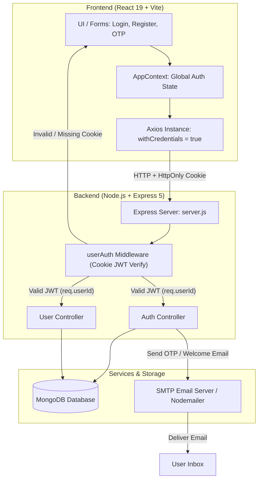

# 🛡️ Advanced MERN Authentication & Authorization System

<div align="center">


<br />

**A production-ready, security-first Authentication System built with the MERN stack.**  
Designed as a comprehensive learning blueprint to master, remember, and revise full-stack architecture, JWT authentication lifecycles, protected routes, automated transactional emails, and centralized state management.

</div>

---

## 📌 Table of Contents

- [✨ Key Features](#-key-features)
- [🏗️ System Architecture & Workflow](#️-system-architecture--workflow)
- [🧠 The "Remember MERN" Revision Guide](#-the-remember-mern-revision-guide)
  - [1. HttpOnly Cookies vs localStorage](#1-httponly-cookies-vs-localstorage)
  - [2. How Express Middleware Works (Airport Security Metaphor)](#2-how-express-middleware-works)
  - [3. The JWT Token Lifecycle](#3-the-jwt-token-lifecycle)
  - [4. Global State with React Context API](#4-global-state-with-react-context-api)
  - [5. Interactive 6-Box OTP UX Architecture](#5-interactive-6-box-otp-ux-architecture)
- [📂 Project Directory Structure](#-project-directory-structure)
- [🔌 API Endpoints Reference](#-api-endpoints-reference)
  - [Authentication Routes (`/api/auth`)](#authentication-routes-apiauth)
  - [User Routes (`/api/user`)](#user-routes-apiuser)
- [⚙️ Environment Configuration](#️-environment-configuration)
- [🚀 Getting Started & Local Installation](#-getting-started--local-installation)
- [🛠️ Tech Stack & Dependencies](#️-tech-stack--dependencies)

---

## ✨ Key Features

- **🔐 Robust Token-Based Authentication:** Sign up, log in, and log out with secure JWT tokens issued in `httpOnly`, `sameSite` cookies (eliminates client-side XSS token theft).
- **🛡️ Custom Auth Middleware (`userAuth.js`):** Intercepts requests, validates JWT signatures, extracts the user ID, and protects private routes.
- **✉️ Transactional Email Integration:** Uses **Nodemailer** with SMTP (Brevo) to send branded HTML emails for onboarding, account verification, and password recovery.
- **🔢 6-Digit OTP Email Verification:** Time-sensitive account verification system with custom HTML email templates and MongoDB expiration tracking.
- **🔑 Secure 3-Step Password Reset:**
  1. User enters registered email $\rightarrow$ 6-digit OTP sent (expires in 15 mins).
  2. User inputs OTP $\rightarrow$ verified against database timestamp.
  3. User supplies a new password $\rightarrow$ hashed with `bcryptjs` (salt rounds: 10) and updated.
- **🗑️ Complete Account Deletion:** Logged-in users can permanently delete their account with a two-step confirmation modal; cleans up database records and clears auth cookies.
- **🌐 Centralized React State Management:** Custom `AppContextProvider` delivers user profile, authentication state, and global utility functions across the entire application without prop drilling.
- **⚡ High-Performance OTP Input Component:** 6-box OTP fields with auto-focus forward jumping, backspace reverse shifting, and native clipboard paste splitting.
- **🎨 Modern Dark & Glassmorphism Aesthetic:** Designed with Tailwind CSS v4, smooth animations, and feedback powered by `react-toastify`.

---

## 🏗️ System Architecture & Workflow



---

## 🧠 The "Remember MERN" Revision Guide

This project was built to internalize core full-stack architectural concepts. Here is the concise memory guide for each key concept:

### 1. HttpOnly Cookies vs localStorage

| Feature | `localStorage` | `httpOnly` Cookie (Implemented Here) |
| :--- | :--- | :--- |
| **Storage Location** | Browser Storage API | Browser Cookie Jar |
| **JavaScript Accessible** | **Yes (`window.localStorage`)** ⚠️ | **No (Protected from JS)** 🛡️ |
| **XSS Vulnerability** | Critical (Malicious script can steal token) | Immune to JavaScript read attacks |
| **Transmission** | Must manually attach to `Authorization` header | Automatically sent with every HTTP request |
| **Configuration** | Handled manually on frontend | Configured on backend: `res.cookie('token', token, { httpOnly: true, sameSite: 'strict', secure: isProd })` |

> **Key Rule to Remember:** When setting cookies cross-origin (production vs local), always set `axios.defaults.withCredentials = true` on the client and `credentials: true` on Express CORS!

---

### 2. How Express Middleware Works

Think of Middleware as **Airport Security**:
```
Incoming Request ──▶ [ Middleware: userAuth ] ──▶ [ Controller ] ──▶ Response
                              │
                    Does request have valid ticket?
                              │
                    ├── NO  ──▶ Denied! 401 / 403 response
                    └── YES ──▶ next() attaches req.userId and passes through
```

```javascript
// server/middleware/userAuth.js
const userAuth = (req, res, next) => {
    const { token } = req.cookies;
    if (!token) return res.json({ success: false, message: "Access denied. No token provided." });

    const decoded = jwt.verify(token, process.env.JWT_SECRET);
    req.userId = decoded.id; // Store user ID inside request object for downstream controllers
    next(); // Pass control to the next handler
};
```

---

### 3. The JWT Token Lifecycle

1. **Generation (Login/Register):**
   ```javascript
   const token = jwt.sign({ id: user._id }, process.env.JWT_SECRET, { expiresIn: '7d' });
   ```
2. **Delivery to Client:**
   ```javascript
   res.cookie('token', token, {
       httpOnly: true,
       secure: process.env.NODE_ENV === 'production',
       sameSite: process.env.NODE_ENV === 'production' ? 'none' : 'strict',
       maxAge: 7 * 24 * 60 * 60 * 1000
   });
   ```
3. **Automatic Verification:** The browser sends the cookie back on every subsequent request. Middleware decodes it using `process.env.JWT_SECRET`.
4. **Invalidation (Logout):**
   ```javascript
   res.clearCookie('token');
   ```

---

### 4. Global State with React Context API

Avoid passing `isLoggedIn`, `userData`, or `getUserData` down manually through every component.

```
            [ AppContextProvider ] (Stores state at root)
                       │
       ┌───────────────┼───────────────┐
       ▼               ▼               ▼
   [ Navbar ]      [ Home ]     [ ResetPassword ]
  (Reads User)   (Renders UI)   (Triggers Auth)
```

- **`main.jsx`:** Wraps `<App />` inside `<AppContextProvider>`.
- **`AppContext.jsx`:** Runs `getAuthStatus()` inside `useEffect` on first mount to verify existing sessions via `/api/auth/is-auth`.
- **Components:** Call `const { userData, isLoggedIn } = useContext(AppContent)`.

---

### 5. Interactive 6-Box OTP UX Architecture

The OTP input fields use `useRef([])` to provide a smooth user experience:

```javascript
// Auto-focus next box on input
const handleInput = (e, index) => {
    if (e.target.value.length > 0 && index < 5) {
        inputRefs.current[index + 1].focus();
    }
};

// Shift focus back on backspace
const handleBackspace = (e, index) => {
    if (e.key === 'Backspace' && e.target.value === '' && index > 0) {
        inputRefs.current[index - 1].focus();
    }
};

// Clipboard paste distribution
const handlePaste = (e) => {
    const paste = e.clipboardData.getData('text').slice(0, 6);
    paste.split('').forEach((char, index) => {
        if (inputRefs.current[index]) inputRefs.current[index].value = char;
    });
};
```

---

## 📂 Project Directory Structure

```plaintext
Auth_System-Remember-MERN/
├── client/                          # Frontend Application (React 19 + Vite)
│   ├── public/                      # Static assets
│   ├── src/
│   │   ├── assets/                  # Icons, illustrations, brand logos
│   │   ├── components/
│   │   │   ├── Header.jsx           # Hero greeting & dynamic user profile banner
│   │   │   └── Navbar.jsx           # Navigation bar, user dropdown & delete modal
│   │   ├── context/
│   │   │   └── AppContext.jsx       # Global Auth state, API bridge & userData store
│   │   ├── pages/
│   │   │   ├── EmailVerify.jsx      # 6-box OTP input for account verification
│   │   │   ├── Home.jsx             # Landing page
│   │   │   ├── Login.jsx            # Sign Up & Sign In toggle forms
│   │   │   └── ResetPassword.jsx    # 3-step OTP password reset screen
│   │   ├── App.jsx                  # Route definitions & ToastContainer
│   │   ├── index.css                # Tailwind CSS v4 styling rules
│   │   └── main.jsx                 # React root DOM mount & Context provider
│   ├── .env.example                 # Client environment variables reference
│   ├── package.json                 # Frontend dependencies & scripts
│   └── vite.config.js               # Vite bundler configuration
│
├── server/                          # Backend Application (Node.js + Express 5)
│   ├── config/
│   │   ├── emailTemplates.js        # HTML templates for verification & password reset
│   │   ├── mongodb.js               # Mongoose database connection setup
│   │   └── nodemailer.js            # SMTP transport setup (Brevo / Nodemailer)
│   ├── controllers/
│   │   ├── authController.js        # Register, Login, Logout, OTP & Reset logic
│   │   └── userController.js        # User profile retrieval logic
│   ├── middleware/
│   │   └── userAuth.js              # JWT cookie authentication barrier
│   ├── model/
│   │   └── userModel.js             # Mongoose User schema (OTP, expiry, flags)
│   ├── routes/
│   │   ├── authRoutes.js            # Auth route definitions
│   │   └── userRoutes.js            # User route definitions
│   ├── .env.example                 # Server environment variables reference
│   ├── package.json                 # Backend dependencies & scripts
│   └── server.js                    # Express app entry point, CORS & port listener
│
├── .gitignore                       # Git ignore rules for both client & server
└── README.md                        # Project documentation & MERN study guide
```

---

## 🔌 API Endpoints Reference

### Authentication Routes (`/api/auth`)

| Method | Endpoint | Protection | Description | Request Body |
| :--- | :--- | :--- | :--- | :--- |
| `POST` | `/api/auth/register` | Public | Create new user account & set auth cookie | `{ name, email, password }` |
| `POST` | `/api/auth/login` | Public | Verify credentials & issue JWT cookie | `{ email, password }` |
| `POST` | `/api/auth/logout` | Public | Clear JWT auth cookie | _None_ |
| `GET` | `/api/auth/is-auth` | 🔒 `userAuth` | Verify if current session cookie is valid | _None_ |
| `POST` | `/api/auth/send-verify-otp` | 🔒 `userAuth` | Generate & email 6-digit verification OTP | _None_ |
| `POST` | `/api/auth/verify-email` | 🔒 `userAuth` | Validate OTP & mark email verified | `{ otp: "123456" }` |
| `POST` | `/api/auth/send-reset-otp` | Public | Generate & email password reset OTP | `{ email: "user@example.com" }` |
| `POST` | `/api/auth/verify-reset-otp` | Public | Validate OTP before allowing password change | `{ email, otp }` |
| `POST` | `/api/auth/reset-password` | Public | Hash & update user password | `{ email, otp, newPassword }` |
| `DELETE` | `/api/auth/delete-account` | 🔒 `userAuth` | Delete user record and clear cookie | _None_ |

### User Routes (`/api/user`)

| Method | Endpoint | Protection | Description | Response Data |
| :--- | :--- | :--- | :--- | :--- |
| `GET` | `/api/user/get-user-data` | 🔒 `userAuth` | Fetch authenticated user's name & verification flag | `{ success: true, userData: { name, isAccountVerified } }` |

---

## ⚙️ Environment Configuration

### Backend: `server/.env`

Create a `.env` file in the `server` directory based on `server/.env.example`:

```env
# Server
PORT=4000
NODE_ENV=development

# Database
MONGODB_URI=mongodb+srv://<username>:<password>@cluster.mongodb.net/<database>?retryWrites=true&w=majority

# Security
JWT_SECRET=your_super_secret_jwt_key_here

# SMTP / Nodemailer (Brevo / SendGrid / Gmail)
SMTP_HOST=smtp-relay.brevo.com
SMTP_PORT=587
SMTP_USER=your_smtp_login_username
SMTP_PASS=your_smtp_api_key_or_password
SMTP_USER_EMAIL=no-reply@yourdomain.com
```

### Frontend: `client/.env`

Create a `.env` file in the `client` directory based on `client/.env.example`:

```env
# Backend Base URL
VITE_BACKEND_URL=http://localhost:4000
```

---

## 🚀 Getting Started & Local Installation

### Prerequisites

Ensure you have the following installed:
- [Node.js](https://nodejs.org/) (v18.0.0 or higher)
- [npm](https://www.npmjs.com/) or [yarn](https://yarnpkg.com/)
- [MongoDB Atlas](https://www.mongodb.com/atlas) account or local MongoDB instance
- [Brevo](https://www.brevo.com/) account (or any SMTP provider) for email delivery

---

### Step 1: Clone the Repository

```bash
git clone https://github.com/your-username/Auth_System-Remember-MERN.git
cd Auth_System-Remember-MERN
```

---

### Step 2: Set Up Backend

1. Navigate to the `server` directory:
   ```bash
   cd server
   ```
2. Install dependencies:
   ```bash
   npm install
   ```
3. Set up environment variables:
   ```bash
   cp .env.example .env
   # Edit .env with your MongoDB URI and SMTP credentials
   ```
4. Start the backend development server (with Nodemon):
   ```bash
   npm run server
   ```
   > Backend will run at: `http://localhost:4000`

---

### Step 3: Set Up Frontend

1. Open a new terminal and navigate to the `client` directory:
   ```bash
   cd client
   ```
2. Install dependencies:
   ```bash
   npm install
   ```
3. Set up environment variables:
   ```bash
   cp .env.example .env
   ```
4. Start the frontend development server:
   ```bash
   npm run dev
   ```
   > Frontend will run at: `http://localhost:5173`

---

## 🛠️ Tech Stack & Dependencies

### Frontend (`/client`)
- **React 19** – UI library
- **Vite 8** – Next-generation build tool & dev server
- **Tailwind CSS v4** – Utility-first modern CSS framework
- **React Router DOM 7** – Client-side SPA navigation
- **Axios** – HTTP client with cookie support (`withCredentials`)
- **React-Toastify** – Interactive notifications and error handling

### Backend (`/server`)
- **Node.js** – Server runtime environment
- **Express 5** – Fast, minimalist web framework
- **MongoDB & Mongoose 9** – NoSQL object modeling & data persistence
- **JSONWebToken (JWT)** – Stateless authentication tokens
- **Bcrypt.js** – Password hashing algorithm
- **Cookie-Parser** – Parsing cookies from incoming requests
- **Nodemailer** – Transactional email transport
- **Cors** – Cross-Origin Resource Sharing
- **Dotenv** – Environment variable management
- **Nodemon** – Development server live-reload

---

## 📝 Learning Reflections & Takeaways

- [x] **Separation of Concerns:** Keep routing (`routes/`), request processing (`controllers/`), schema models (`model/`), and security gates (`middleware/`) clearly isolated.
- [x] **Stateless Security:** Storing JWTs inside `httpOnly` cookies gives the security of server-side sessions with the scalability of stateless JWTs.
- [x] **Safe Password Storage:** Passwords should never be stored in plain text. Always use salted hashes (`bcrypt.hash(password, 10)`).
- [x] **OTP Security Design:** Always store OTPs alongside an expiration timestamp (`Date.now() + 15 * 60 * 1000`) and clear them immediately once used.
- [x] **User Experience Polish:** Smooth multi-box input navigation and toast notifications make an authentication flow feel intuitive.

---

<div align="center">
  <sub>Built with ❤️ as part of the MERN Stack Mastery Journey.</sub>
</div>
